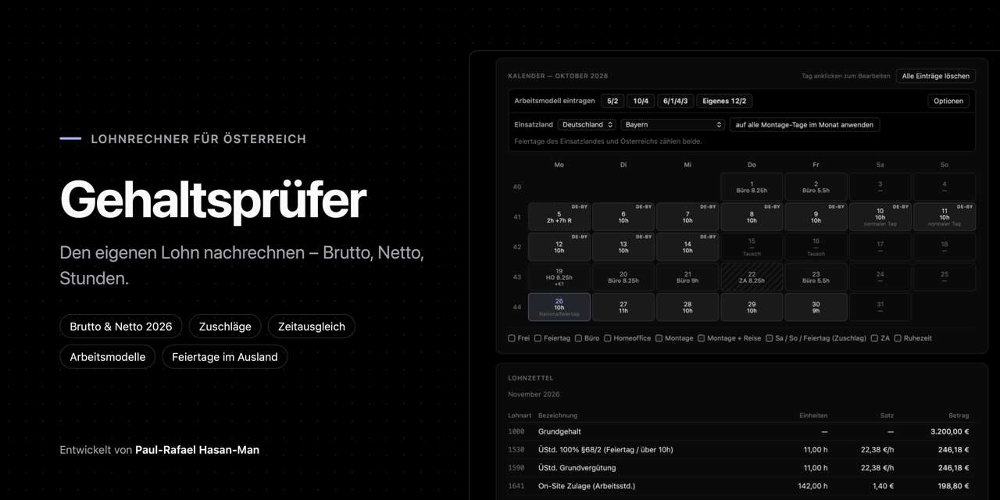

<p align="center">
  
</p>

<p align="center">
  <a href="https://paul-rafael.github.io/gehaltspruefer/"></a>
  <a href="https://github.com/paul-rafael/gehaltspruefer/releases"></a>
  <a href="https://github.com/paul-rafael/gehaltspruefer/actions/workflows/ci.yml"></a>
  <a href="LICENSE"></a>
  
</p>

<p align="center">
  <b>Den eigenen Lohn nachrechnen – Brutto, Netto, Stunden. Für Österreich.</b><br>
  Eine einzige HTML-Datei: ohne Installation, ohne Server, ohne Konto. Alle Daten bleiben im eigenen Browser.
</p>

<p align="center">
  <a href="https://paul-rafael.github.io/gehaltspruefer/"><b>Gehaltsprüfer öffnen →</b></a>
</p>

---

## Überblick

Der Gehaltsprüfer ist ein Lohnrechner für Arbeitnehmerinnen und Arbeitnehmer in Österreich. Man trägt die Arbeitstage eines Monats in einen Kalender ein – Büro, Homeoffice, Außeneinsatz, Reise, Zeitausgleich – und erhält daraus den voraussichtlichen Lohnzettel mit Zuschlägen, Zulagen, Zeitkonten und einer Netto-Schätzung nach den Werten 2026. So lässt sich die eigene Abrechnung Zeile für Zeile nachvollziehen.

<p align="center">
  
</p>

## Funktionen

| Bereich | Beschreibung |
| --- | --- |
| **Kalender** | Büro, Homeoffice, Einsatz, Einsatz mit Reise, Zeitausgleich und Ruhezeit; Tage kopieren und einfügen |
| **Arbeitsmodelle** | 5/2, 10/4, 6/1/4/3 und ein eigenes Modell per Klick |
| **Arbeitszeit** | Normalarbeitszeit Mo–Do 8,25 h, Fr 5,5 h; Mehrstunden in den ZA-Topf; Überstunden über 10 h/Tag und 50 h/Woche |
| **Zuschläge** | Samstag 50 %, Sonntag und Feiertag 100 %, Lenkzeit, Zulagen, Prämien |
| **Zeitkonten** | ZA-Topf mit Maximum und Überlauf, Ruhezeit-Topf aus Sonntagsarbeit |
| **Feiertage** | Österreich sowie bei Einsätzen im Ausland zusätzlich DE (je Bundesland), CH, FR, IT, NL, BE, LU, ES |
| **Netto 2026** | Sozialversicherung mit Höchstbeitragsgrundlage, Lohnsteuer-Tarif 2026, steuerfreie Zuschläge nach §68, Taggeld, Urlaubsgeld nach §67 |
| **Lehrlinge** | Reduzierter SV-Satz per Schalter |
| **Datensätze** | Monate speichern, laden, exportieren und importieren; Folgemonat mit Salden starten |
| **Einstellungen** | Grundgehalt, Stundenteiler und Standard-Stunden je Tagesart – optional fest in der Datei gespeichert |

<details>
<summary><b>Stundenübersicht mit Wochensummen</b></summary>
<br>
<p align="center"></p>
</details>

## Benutzung

**Online:** [paul-rafael.github.io/gehaltspruefer](https://paul-rafael.github.io/gehaltspruefer/)

**Offline:** [`index.html`](index.html) bzw. die Datei aus dem [neuesten Release](https://github.com/paul-rafael/gehaltspruefer/releases/latest) herunterladen und im Browser öffnen.

1. Unter **Einstellungen** einmalig Grundgehalt, Taggeld und Standard-Stunden eintragen.
2. Monat wählen und Tage im Kalender anklicken – oder ein **Arbeitsmodell** auf den ersten Arbeitstag setzen.
3. Bei Einsätzen im Ausland das **Einsatzland** wählen.
4. Ergebnis mit dem eigenen Lohnzettel vergleichen.

## Rechengrundlagen 2026

| Thema | Wert |
| --- | --- |
| SV-Dienstnehmeranteil | 18,07 % (Sonderzahlungen 17,07 %), reduzierter AV-Anteil bei geringem Einkommen |
| Höchstbeitragsgrundlage | 6.930 € monatlich, 13.860 € jährlich für Sonderzahlungen |
| Lohnsteuer | Tarif 2026 (0 / 20 / 30 / 40 / 48 / 50 / 55 %), Verkehrsabsetzbetrag 496 €, Werbungskostenpauschale |
| §68 Abs. 1 EStG | Sonn- und Feiertagszuschläge inkl. Feiertagsarbeitsentgelt bis 400 € steuerfrei |
| §68 Abs. 2 EStG | Überstundenzuschläge der ersten 15 Stunden, höchstens 170 € steuerfrei |
| Taggeld | Steuer- und SV-frei bis zum Inlandssatz (30 €) bzw. Auslandsreisesatz |
| Sonderzahlungen §67 | 6 % nach Abzug der SV, 620 € Freibetrag, 2.100 € Freigrenze |
| Stundensatz | Grundgehalt ÷ 143 (einstellbar) |

Quellen: [ÖGK – Veränderliche Werte 2026](https://www.oegk.at/cdscontent/?contentid=10007.908421&portal=oegkdgportal) · [WKO – Beitragswesen 2026](https://www.wko.at/entlohnung/beitragswesen-dienstnehmer-2026) · [WKO – Auslandsreisesätze](https://www.wko.at/entlohnung/auslandsreise-kostensaetze) · [Sozialversicherung – Lehrlinge](https://www.sozialversicherung.gv.at/cdscontent/?contentid=10007.905068)

## Datenschutz

- Keine Anmeldung, kein Tracking, keine externen Skripte.
- Einstellungen und Datensätze bleiben im `localStorage` des eigenen Browsers.
- Eine automatische Prüfung verhindert, dass persönliche Einstellungen in `index.html` veröffentlicht werden.

## Entwicklung

```bash
npm install      # Test-Umgebung
npm run check    # Syntax-, Datenschutz- und Emoji-Prüfung
npm test         # Rechen-Tests
```

Tests laufen bei jeder Änderung automatisch über GitHub Actions. Siehe auch [CONTRIBUTING.md](CONTRIBUTING.md) und [CHANGELOG.md](CHANGELOG.md).

## Haftungsausschluss

Alle Ergebnisse sind Näherungswerte. Kollektivverträge, Betriebsvereinbarungen und persönliche Absetzbeträge (z. B. Pendlerpauschale, Familienbonus Plus) können zu Abweichungen führen. Der Gehaltsprüfer ersetzt keine Lohn- oder Steuerberatung; verbindlich ist ausschließlich die Abrechnung des Arbeitgebers.

## Lizenz

[MIT](LICENSE) © 2026 Paul-Rafael Hasan-Man

---

<p align="center"><sub>Entwickelt von <b>Paul-Rafael Hasan-Man</b></sub></p>
