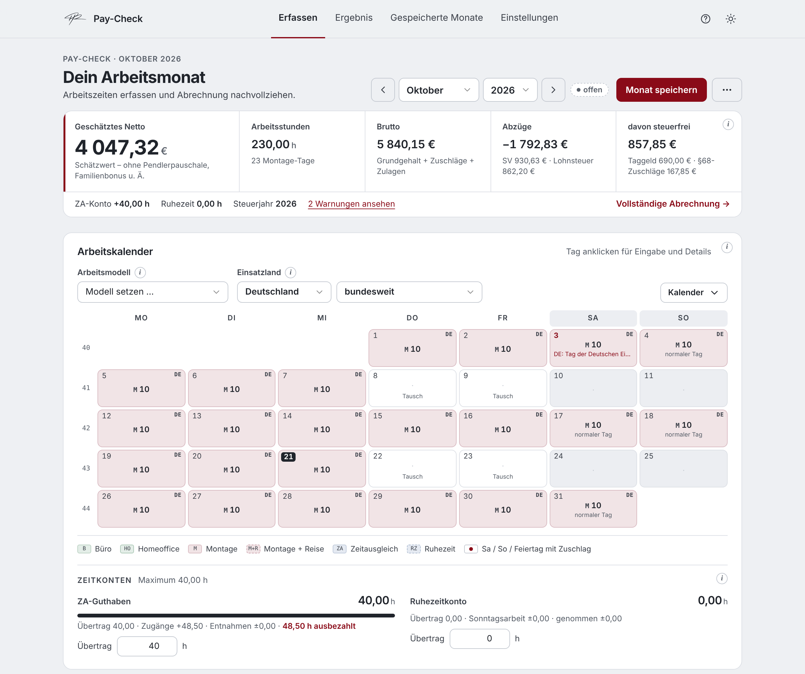
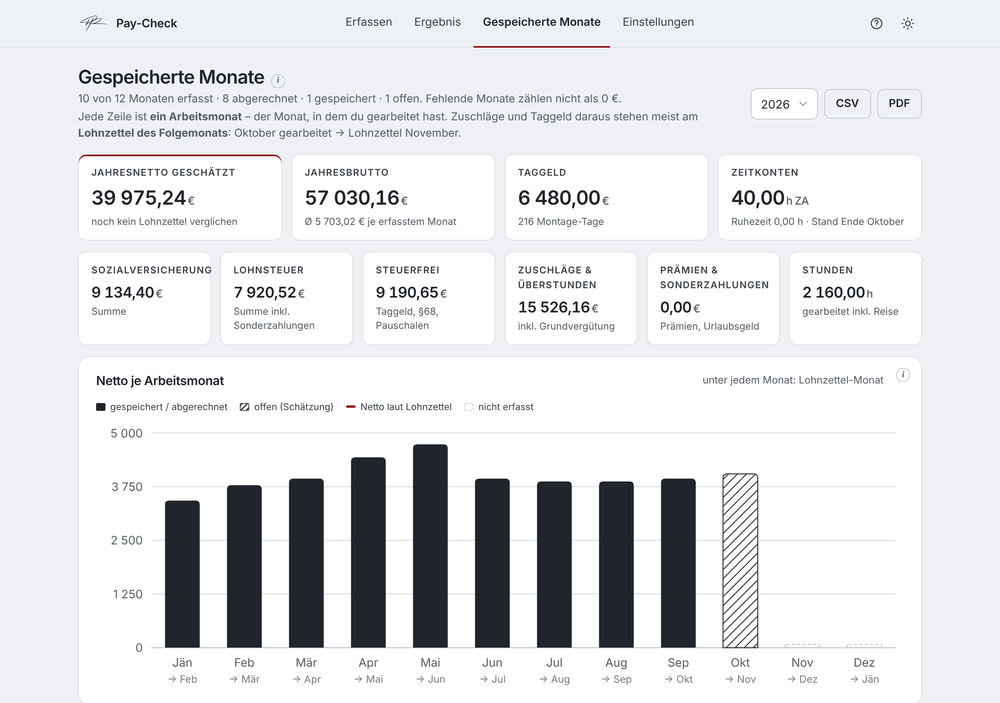

<div align="center">

# Einsatzrechner

Einsätze erfassen. Lohn nachrechnen. Lohnzettel prüfen.

<a href="https://paul-rafael.github.io/einsatzrechner/"></a>
<a href="https://github.com/paul-rafael/einsatzrechner/releases/latest"></a>
<a href="https://github.com/paul-rafael/einsatzrechner/actions/workflows/ci.yml"></a>
<a href="LICENSE"></a>

**[Einsatzrechner öffnen →](https://paul-rafael.github.io/einsatzrechner/)**



</div>

---

Der Einsatzrechner ist ein privates Werkzeug für alle, die auf Montage, auf Reise oder im Schichtmodell arbeiten und ihren Lohn nach österreichischem Recht nachrechnen wollen. Du trägst die Arbeitstage eines Monats in einen Kalender ein – Büro, Homeoffice, Montage, Reise, Zeitausgleich – und siehst sofort den voraussichtlichen Lohnzettel mit Zuschlägen, Zulagen, Zeitkonten und einer Netto-Schätzung. Danach vergleichst du ihn mit deinem echten Lohnzettel und behältst in der Jahresübersicht Einkommen und Zeitkonten im Blick.

Der Rechner ist eine einzige HTML-Datei: ohne Installation, ohne Server, ohne Konto.

## Funktionen

| Bereich | Beschreibung |
| --- | --- |
| Erfassen | Kalender mit Tagesdetails, Arbeitsmodelle, Einsatzland, Bezahlung und Zeitkonten – das geschätzte Netto steht immer oben |
| Ergebnis | Netto als Hauptzahl, Brutto, Abzüge und steuerfreie Anteile; vollständiger Lohnzettel, Brutto-Netto-Rechnung und Soll-Ist-Vergleich |
| Kalender | Büro, Homeoffice, Montage, Montage mit Reise, Zeitausgleich und Ruhezeit mit Farbe und Kürzel; Tage kopieren und einfügen |
| Arbeitsmodelle | 5/2, 10/4, 6/1/4/3 und eigene Modelle; einmalig oder fortlaufend über Monatsgrenzen; früheren Monat als Vorlage |
| Arbeitszeit | Normalarbeitszeit Mo–Do 8,25 h, Fr 5,5 h; Mehrstunden in den ZA-Topf; Überstunden über 10 h/Tag und 50 h/Woche |
| Zuschläge | Samstag 50 %, Sonntag und Feiertag 100 %, Lenkzeit, Zulagen, Prämien; Sätze in den erweiterten Einstellungen änderbar |
| Zeitkonten | ZA- und Ruhezeit-Topf mit Start, Zugängen, Entnahmen und Ende; automatischer Übertrag in den Folgemonat |
| Feiertage | Österreich; an Montage-Tagen im Ausland nur die Feiertage des Einsatzlandes: DE (je Bundesland), CH, FR, IT, NL, BE, LU, ES |
| Netto | SV mit Höchstbeitragsgrundlage, Lohnsteuer-Tarif, steuerfreie Zuschläge nach §68, Taggeld, Urlaubsgeld nach §67 – Werte je Steuerjahr (2025, 2026) |
| Soll-Ist-Vergleich | Beträge des echten Lohnzettels je Lohnart eintragen, Differenzen nach Bereichen mit möglichen Ursachen, Abweichungen als geklärt markieren |
| Jahresübersicht | Jahresbrutto, -netto, Taggeld, SV, Lohnsteuer, Zuschläge; Netto je Monat, Zeitkonten-Verlauf, Monatstabelle; fehlende Monate zählen nicht als 0 € |
| Gespeicherte Monate | Jahresübersicht und alle Monate mit Status offen / gespeichert / abgerechnet / geändert / veraltet; Monate vergleichen; bewusste Neuberechnung mit Verlauf |
| Hinweise | Warnungen bei über 12 h am Tag, über 60 h pro Woche, vollem ZA-Topf, fehlendem Taggeld; alle Annahmen sichtbar |
| Daten | Automatisches Speichern im Browser, CSV und PDF für Monat und Jahr, Gesamtsicherung, Import, vollständiges Löschen |
| Lehrlinge | Reduzierter SV-Satz per Schalter |

## Highlights

- **Nachvollziehbar** – steuerfreie Anteile werden einzeln ausgewiesen, z. B. „von 1.272,96 € – Rest 1.102,96 € steuerpflichtig“.
- **Aktuelle Werte** – Sozialversicherung, Lohnsteuer und §68-Grenzen je Steuerjahr, Taggeld-Sätze je Land, mit Quellen.
- **Ehrlich** – Schätzungen sind gekennzeichnet, Annahmen werden angezeigt, gespeicherte Abrechnungen ändern sich nie von selbst.
- **Privat** – keine Anmeldung, kein Tracking, keine externen Skripte. Daten bleiben im eigenen Browser.
- **Offline** – die Datei funktioniert auch ohne Internet, z. B. auf Montage.
- **Geprüft** – Rechen-Tests laufen bei jeder Änderung automatisch.

<details>
<summary>Jahresübersicht</summary>
<br>

</details>

## Nutzung

**Online:** [paul-rafael.github.io/einsatzrechner](https://paul-rafael.github.io/einsatzrechner/)

**Offline:** `einsatzrechner.html` aus dem [neuesten Release](https://github.com/paul-rafael/einsatzrechner/releases/latest) herunterladen und im Browser öffnen.

1. In den **Einstellungen** (Zahnrad) einmal Grundgehalt, Taggeld, Standard-Stunden und Arbeitsmodell eintragen.
2. Unter **Erfassen** Tage anklicken oder ein Arbeitsmodell setzen – Eingaben werden automatisch gespeichert, das Netto steht sofort oben.
3. Bei Einsätzen im Ausland das **Einsatzland** wählen.
4. Unter **Ergebnis** den Monat speichern, im **Soll-Ist-Vergleich** mit dem Lohnzettel prüfen und als **abgerechnet** markieren.
5. Unter **Gespeicherte Monate** Jahr, Einkommen und Zeitkonten verfolgen.

## Entwicklung

```bash
npm install      # Test-Umgebung
npm run check    # Syntax-, Datenschutz- und Emoji-Prüfung
npm test         # Rechen- und Funktionstests
```

Tests laufen bei jedem Push über GitHub Actions. Hinweise zum Mitwirken stehen in [CONTRIBUTING.md](CONTRIBUTING.md).

## Projektstruktur

```
index.html              Der Rechner (eine Datei): Rechenkern und Oberfläche als getrennte Skripte, inkl. PRH Design Kit
docs/                   Screenshots und Vorschaubild
tests/                  Rechen- und Funktionstests (node:test + jsdom), Referenzwerte in tests/fixtures/
scripts/check.mjs       Statische Prüfungen
.github/                CI- und Release-Workflow, Issue- und PR-Vorlagen
```

## Dokumentation

**Rechengrundlagen 2026** (die Werte 2025 sind ebenfalls hinterlegt und unter Einstellungen einsehbar)

| Thema | Wert |
| --- | --- |
| SV-Dienstnehmeranteil | 18,07 % (Sonderzahlungen 17,07 %), reduzierter AV-Anteil bei geringem Einkommen |
| Höchstbeitragsgrundlage | 6.930 € monatlich, 13.860 € jährlich für Sonderzahlungen |
| Lohnsteuer | Tarif 2026 (0 / 20 / 30 / 40 / 48 / 50 / 55 %), Verkehrsabsetzbetrag 496 €, Werbungskostenpauschale |
| §68 Abs. 1 EStG | Sonn- und Feiertagszuschläge inkl. Feiertagsarbeitsentgelt bis 400 € steuerfrei |
| §68 Abs. 2 EStG | Überstundenzuschläge der ersten 15 Stunden, höchstens 170 € steuerfrei |
| Taggeld | Steuer- und SV-frei bis zum Inlandssatz (30 €) bzw. Auslandsreisesatz |
| Sonderzahlungen §67 | 6 % nach Abzug der SV, 620 € Freibetrag, 2.100 € Freigrenze |
| Stundensatz | Grundgehalt ÷ 143 (einstellbar) |

Quellen: [ÖGK – Veränderliche Werte 2026](https://www.oegk.at/cdscontent/?contentid=10007.908421&portal=oegkdgportal) · [WKO – Beitragswesen 2026](https://www.wko.at/entlohnung/beitragswesen-dienstnehmer-2026) · [WKO – Auslandsreisesätze](https://www.wko.at/entlohnung/auslandsreise-kostensaetze) · [Sozialversicherung – Lehrlinge](https://www.sozialversicherung.gv.at/cdscontent/?contentid=10007.905068)

**Weitere Dokumente:** [CHANGELOG.md](CHANGELOG.md) · [CONTRIBUTING.md](CONTRIBUTING.md) · [LICENSE](LICENSE)

**Haftungsausschluss:** Alle Ergebnisse sind Näherungswerte. Kollektivverträge, Betriebsvereinbarungen und persönliche Absetzbeträge (z. B. Pendlerpauschale, Familienbonus Plus) können zu Abweichungen führen. Der Einsatzrechner ersetzt keine Lohn- oder Steuerberatung; verbindlich ist ausschließlich die Abrechnung des Arbeitgebers.

---

<p align="center"><sub>Entwickelt von <b>Paul-Rafael Hasan-Man</b></sub></p>
