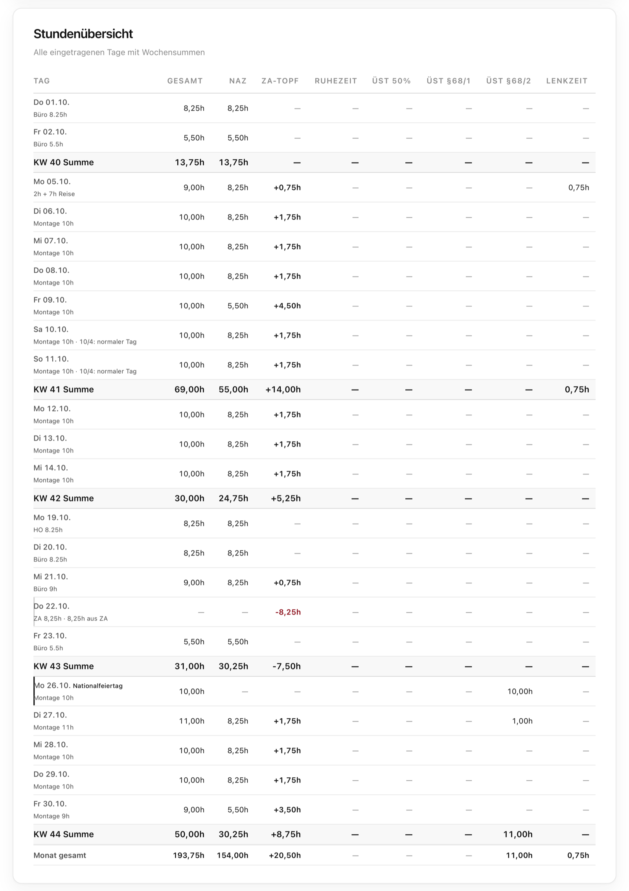

<div align="center">

# Gehaltsprüfer

Den eigenen Lohn nachrechnen – Brutto, Netto, Stunden. Für Österreich.

<a href="https://paul-rafael.github.io/gehaltspruefer/"></a>
<a href="https://github.com/paul-rafael/gehaltspruefer/releases/latest"></a>
<a href="https://github.com/paul-rafael/gehaltspruefer/actions/workflows/ci.yml"></a>
<a href="LICENSE"></a>

**[Gehaltsprüfer öffnen →](https://paul-rafael.github.io/gehaltspruefer/)**


</div>

---

Der Gehaltsprüfer ist ein Lohnrechner für Österreich. Du trägst die Arbeitstage eines Monats in einen Kalender ein – Büro, Homeoffice, Einsatz, Reise, Zeitausgleich – und siehst daraus den voraussichtlichen Lohnzettel mit Zuschlägen, Zulagen, Zeitkonten und einer Netto-Schätzung nach den Werten 2026. So kannst du deine Abrechnung Zeile für Zeile nachvollziehen.

Der Rechner ist eine einzige HTML-Datei: ohne Installation, ohne Server, ohne Konto.

## Funktionen

| Bereich | Beschreibung |
| --- | --- |
| Kalender | Büro, Homeoffice, Einsatz, Einsatz mit Reise, Zeitausgleich und Ruhezeit; Tage kopieren und einfügen |
| Arbeitsmodelle | 5/2, 10/4, 6/1/4/3 und ein eigenes Modell per Klick |
| Arbeitszeit | Normalarbeitszeit Mo–Do 8,25 h, Fr 5,5 h; Mehrstunden in den ZA-Topf; Überstunden über 10 h/Tag und 50 h/Woche |
| Zuschläge | Samstag 50 %, Sonntag und Feiertag 100 %, Lenkzeit, Zulagen, Prämien |
| Zeitkonten | ZA-Topf mit Maximum und Überlauf, Ruhezeit-Topf aus Sonntagsarbeit |
| Feiertage | Österreich; an Montage-Tagen im Ausland nur die Feiertage des Einsatzlandes: DE (je Bundesland), CH, FR, IT, NL, BE, LU, ES |
| Netto 2026 | Sozialversicherung mit Höchstbeitragsgrundlage, Lohnsteuer-Tarif 2026, steuerfreie Zuschläge nach §68, Taggeld, Urlaubsgeld nach §67 |
| Lehrlinge | Reduzierter SV-Satz per Schalter |
| Datensätze | Monate speichern, laden, exportieren und importieren; Folgemonat mit Salden starten |
| Einstellungen | Grundgehalt, Stundenteiler und Standard-Stunden je Tagesart, optional fest in der Datei gespeichert |

## Highlights

- **Nachvollziehbar** – steuerfreie Anteile werden einzeln ausgewiesen, z. B. „von 1.272,96 € – Rest 1.102,96 € steuerpflichtig“.
- **Aktuelle Werte** – Sozialversicherung, Lohnsteuer, §68-Grenzen und Taggeld-Sätze nach Stand 2026, mit Quellen.
- **Privat** – keine Anmeldung, kein Tracking, keine externen Skripte. Daten bleiben im eigenen Browser.
- **Offline** – die Datei funktioniert auch ohne Internet, z. B. auf Montage.
- **Geprüft** – Rechen-Tests laufen bei jeder Änderung automatisch.

<details>
<summary>Stundenübersicht mit Wochensummen</summary>
<br>

</details>

## Nutzung

**Online:** [paul-rafael.github.io/gehaltspruefer](https://paul-rafael.github.io/gehaltspruefer/)

**Offline:** `gehaltspruefer.html` aus dem [neuesten Release](https://github.com/paul-rafael/gehaltspruefer/releases/latest) herunterladen und im Browser öffnen.

1. Unter **Einstellungen** einmal Grundgehalt, Taggeld und Standard-Stunden eintragen.
2. Monat wählen und Tage anklicken – oder ein **Arbeitsmodell** auf den ersten Arbeitstag setzen.
3. Bei Einsätzen im Ausland das **Einsatzland** wählen.
4. Ergebnis mit dem eigenen Lohnzettel vergleichen und den Monat als **Datensatz** speichern.

## Entwicklung

```bash
npm install      # Test-Umgebung
npm run check    # Syntax-, Datenschutz- und Emoji-Prüfung
npm test         # Rechen-Tests
```

Tests laufen bei jedem Push über GitHub Actions. Hinweise zum Mitwirken stehen in [CONTRIBUTING.md](CONTRIBUTING.md).

## Projektstruktur

```
index.html              Der Rechner (eine Datei, inkl. PRH Design Kit, Logo und Favicon)
docs/                   Screenshots und Vorschaubild
tests/                  Rechen-Tests (node:test + jsdom)
scripts/check.mjs       Statische Prüfungen
.github/                CI-Workflow, Issue- und PR-Vorlagen
```

## Dokumentation

**Rechengrundlagen 2026**

| Thema | Wert |
| --- | --- |
| SV-Dienstnehmeranteil | 18,07 % (Sonderzahlungen 17,07 %), reduzierter AV-Anteil bei geringem Einkommen |
| Höchstbeitragsgrundlage | 6.930 € monatlich, 13.860 € jährlich für Sonderzahlungen |
| Lohnsteuer | Tarif 2026 (0 / 20 / 30 / 40 / 48 / 50 / 55 %), Verkehrsabsetzbetrag 496 €, Werbungskostenpauschale |
| §68 Abs. 1 EStG | Sonn- und Feiertagszuschläge inkl. Feiertagsarbeitsentgelt bis 400 € steuerfrei |
| §68 Abs. 2 EStG | Überstundenzuschläge der ersten 15 Stunden, höchstens 170 € steuerfrei |
| Taggeld | Steuer- und SV-frei bis zum Inlandssatz (30 €) bzw. Auslandsreisesatz |
| Sonderzahlungen §67 | 6 % nach Abzug der SV, 620 € Freibetrag, 2.100 € Freigrenze |
| Stundensatz | Grundgehalt ÷ 143 (einstellbar) |

Quellen: [ÖGK – Veränderliche Werte 2026](https://www.oegk.at/cdscontent/?contentid=10007.908421&portal=oegkdgportal) · [WKO – Beitragswesen 2026](https://www.wko.at/entlohnung/beitragswesen-dienstnehmer-2026) · [WKO – Auslandsreisesätze](https://www.wko.at/entlohnung/auslandsreise-kostensaetze) · [Sozialversicherung – Lehrlinge](https://www.sozialversicherung.gv.at/cdscontent/?contentid=10007.905068)

**Weitere Dokumente:** [CHANGELOG.md](CHANGELOG.md) · [CONTRIBUTING.md](CONTRIBUTING.md) · [LICENSE](LICENSE)

**Haftungsausschluss:** Alle Ergebnisse sind Näherungswerte. Kollektivverträge, Betriebsvereinbarungen und persönliche Absetzbeträge (z. B. Pendlerpauschale, Familienbonus Plus) können zu Abweichungen führen. Der Gehaltsprüfer ersetzt keine Lohn- oder Steuerberatung; verbindlich ist ausschließlich die Abrechnung des Arbeitgebers.

---

<p align="center"><sub>Entwickelt von <b>Paul-Rafael Hasan-Man</b></sub></p>
